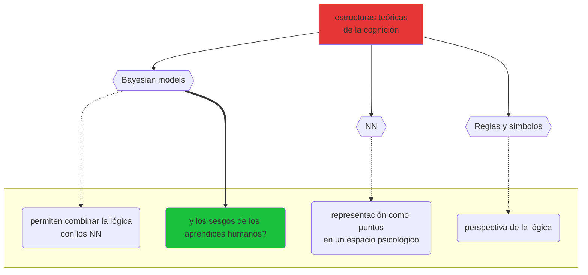

\---

```mermaid

```


```mermaid
mindmap

AI basada en reglas 
	: estos sistemas operan sobre un grupo definido de reglas, creadas por expertos humanos, que dictan el comportamiento del sistema en respuesta a inputs específicos
	: ejemplo - primeros videojuegos, Pac-Man (Inky, Blinky, Pinky, Clyde)
	: ventajas - diseño simple, comportamiento predecible y comprensible
	: desventajas - poca flexibilidad y adapatbilidad, muchas reglas para comportamientos complejos

AI predictiva 
	: usan modelos estadísticos y datos históricos, para predecir futuros resultados, se apoyan en análisis de regresión, ML y modelos probabilísticos
	: ejemplo - autocorrector en los smartphones
	: ventajas - puede manejar la incertidumbre, mejora con más datos
	: desventajas - las predicciones pueden ser incorrectas, especialmente con datos insuficientes o sesgados y requiere muchos datos para entrenamiento y ajuste fino
	
AI Generativa 
	: sistemas que crean nuevo contenido, aprendiendo patrones de datos existentes, basados en modelos de ML, sobre todo redes neuronales, tales como GANs (Genrative Adversarial Networks) y Transformers.
	: ejemplo - ChatGPT desarrollado por OpenAI
	: ventajas - outputs muy creativos y reales, y puede adaptarse a un amplio rango de aplicaciones, desde generación de texto a creación de imágenes
	: desventajas - puede parecer plausible pero ser incorrecto o no tener sentido (alucinaciones), además requiere muchos recursos computacionales y grandes bases de datos de entrenamiento
```